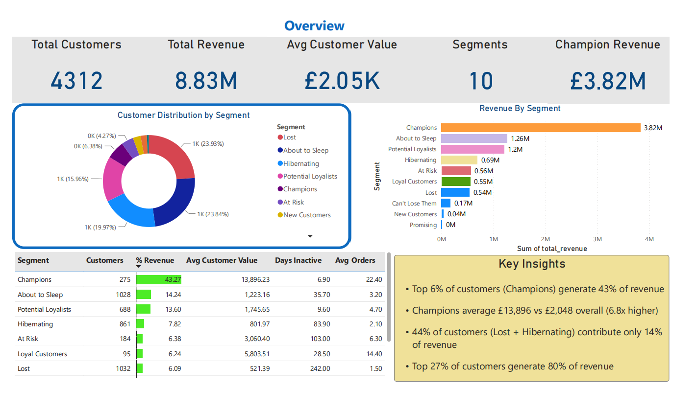
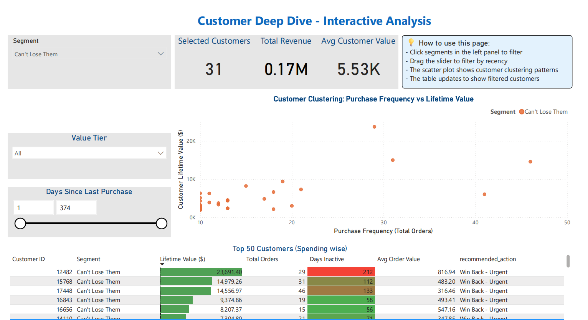

# Customer Segmentation & RFM Analysis

RFM (Recency, Frequency, Monetary) segmentation of a UK online giftware retailer. Transactions are cleaned and scored in Python, loaded into MySQL for a SQL analysis layer, and explored in a two-page Power BI report.

**Stack:** Python (pandas) · SQL (MySQL) · Power BI

**Data:** [Online Retail II](https://archive.ics.uci.edu/dataset/502/online+retail+ii) (UCI), `Year 2009-2010` sheet: 525,461 invoice lines, 4,312 identified customers, £8.83M identified-customer revenue

**Question:** Who are the most valuable customers, who is drifting away, and where should retention effort go?

## Key findings

- **Champions are 6.4% of customers (275) and bring in 43.3% of revenue.** They average £13,896 against £2,048 for all customers.
- **27.3% of customers generate 80% of revenue.**
- **Lost and Hibernating together are 44% of customers but 14% of revenue.**
- **32.9% of customers bought only once** during the year.

## Dashboard

**Overview**



**Customer Deep Dive**: filter by segment, value tier and days since last purchase; the scatter and the top-50 table update with the filters.



## Segments

| Segment | Customers | % of customers | % of revenue | Avg value (£) |
|---|---:|---:|---:|---:|
| Champions | 275 | 6.38 | 43.27 | 13,896 |
| About to Sleep | 1,028 | 23.84 | 14.24 | 1,223 |
| Potential Loyalists | 688 | 15.96 | 13.60 | 1,746 |
| Hibernating | 861 | 19.97 | 7.82 | 802 |
| At Risk | 184 | 4.27 | 6.38 | 3,060 |
| Loyal Customers | 95 | 2.20 | 6.24 | 5,804 |
| Lost | 1,032 | 23.93 | 6.09 | 521 |
| Can't Lose Them | 31 | 0.72 | 1.94 | 5,531 |
| New Customers | 117 | 2.71 | 0.42 | 319 |
| Promising | 1 | 0.02 | 0.00 | 373 |

## How it works

1. **Clean** (`RFM.ipynb`): drop rows with no Customer ID, since they can't be tied to a person, and drop returns and cancellations.
2. **Score**: Recency (days since last purchase) and Monetary (total spend) are scored 1 to 4 by quartile. Frequency (distinct invoices) uses fixed bands of 1, 2 to 4, 5 to 9 and 10 or more, because a third of customers bought exactly once and quartiles can't split that many ties.
3. **Segment**: 10 named segments from the three scores, with narrow rules checked before broad ones.
4. **Analyse** (`rfm_Query.sql`): builds the database, loads the scored customers, and creates a segment summary, Champion and At-Risk drill-downs, a Pareto query, and three views for Power BI. The views add a recommended action and a value tier to every customer.

## Version history

The first version reported 108,214 customers. That was wrong: each row with no Customer ID had been given its own synthetic ID, so 107,927 anonymous line items were counted as customers. Tie-breaking in the frequency score then ranked some of those rows above real repeat buyers, and two segment rules were ordered so that *Can't Lose Them* and *Lost* could never be assigned. The current version fixes all three, and the notebook's opening note shows the before and after.

## Repo structure

```
RFM.ipynb                  Python: clean -> RFM metrics -> scoring -> segments -> CSV export
rfm_analysis_clean.csv     scored customers (output of the notebook, input to SQL)
rfm_Query.sql              MySQL: build database, load CSV, analysis queries, views
dashboard/
  Ecom_Analytics.pbix      Power BI report (Overview + Customer Deep Dive)
  Overview.png
  Deep_Dive.png
```

## Reproduce

1. Download `online_retail_II.xlsx` from [UCI](https://archive.ics.uci.edu/dataset/502/online+retail+ii) or the [Kaggle mirror](https://www.kaggle.com/datasets/lakshmi25npathi/online-retail-dataset), and run `RFM.ipynb` to produce `rfm_analysis_clean.csv`.
2. In `rfm_Query.sql`, change the `LOAD DATA LOCAL INFILE` path to where your CSV is. MySQL Workbench needs `OPT_LOCAL_INFILE=1` under Edit Connection → Advanced → Others.
3. Run the whole script. It drops and rebuilds the `ecommerce_analytics` database.
4. Open `dashboard/Ecom_Analytics.pbix` and refresh.

## Notes on the data

- **Anonymous rows:** 107,927 rows across 5,229 invoices (£1.19M) have no Customer ID. That revenue is real but can't be attributed to a customer, so every revenue figure here is identified-customer revenue.
- **Returns:** 9,870 return and cancellation rows (£-483,795) are excluded rather than netted, which slightly overstates lifetime value for customers who returned goods.
- **Dates** are shifted forward 14 years for presentation. Recency is measured from the last date in the data.
- **Scope** is the 2009-2010 sheet only; the file also has 2010-2011.
- **Currency** is GBP.
